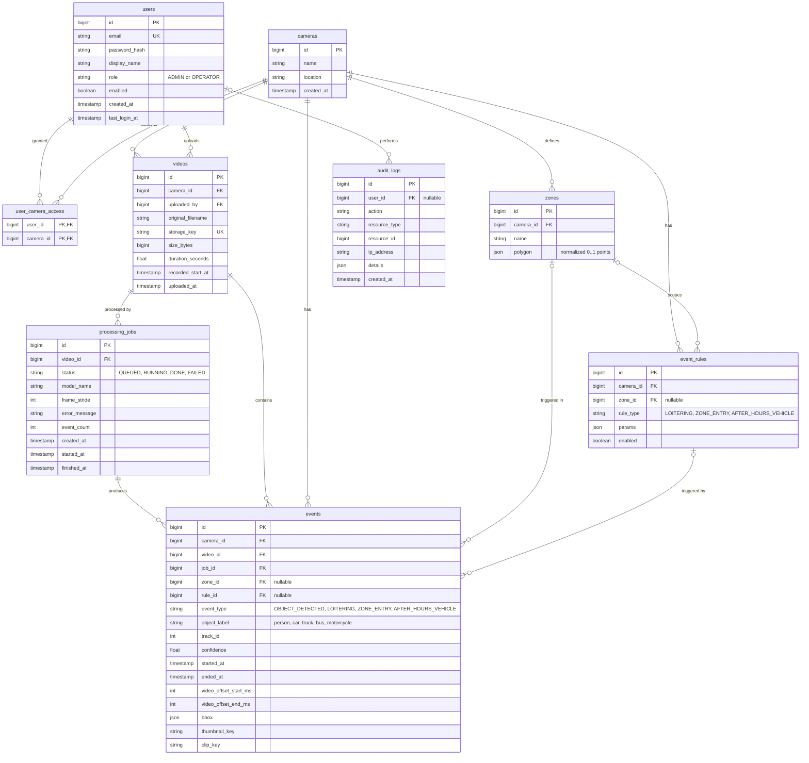

# Database Design

Status: Week 2 deliverable. Version 0.1, 2026-10-06.
Related: [requirements](01-requirements.md), [architecture](03-architecture.md).

## 1. Entity-relationship diagram

## 2. Table notes

| Table | Notes |
|---|---|
| `users` | Email is unique. Role is `ADMIN` or `OPERATOR`. Disabled users cannot log in. |
| `cameras` | A named logical source. There is no stream URL because input is uploaded footage. |
| `user_camera_access` | Join table. An operator sees a camera only if a row exists. Admins see all cameras. |
| `zones` | Polygon stored as JSON points normalized to 0..1, independent of video resolution. |
| `event_rules` | One row per enabled rule. `params` holds rule settings, for example `{"minSeconds":30}` or `{"start":"22:00","end":"06:00"}`. |
| `videos` | `recorded_start_at` is the time the footage was captured, supplied at upload. All event times derive from it. `storage_key` is generated, never the user's file name. |
| `processing_jobs` | One row per processing run. Keeps status, errors and which model was used, so results can be traced and re-run. |
| `events` | One row per tracked object or triggered rule. `started_at` equals the video's `recorded_start_at` plus the offset. `camera_id` is stored on the event for fast filtering. |
| `audit_logs` | Append-only. `user_id` is nullable for failed logins where no user matched. |

## 3. Indexes

| Index | Serves |
|---|---|
| `events (camera_id, started_at DESC)` | The main search: events for a camera in a time range |
| `events (event_type, started_at DESC)` | Search by event type |
| `events (object_label)` | Filter by person or vehicle type |
| `events (job_id)` | Replace or delete a job's events |
| `videos (camera_id, uploaded_at DESC)` | Footage list per camera |
| `audit_logs (created_at DESC)` | Admin audit view |
| `audit_logs (user_id, created_at DESC)` | Audit view filtered by user |
| `users (email)` unique | Login lookup |

## 4. Integrity and deletion rules

- Deleting a video removes its jobs and events (cascade) and the API removes its stored clips and thumbnails. The deletion is written to the audit log first.
- Deleting a camera is blocked while it has videos, unless the admin confirms deleting them too.
- The last active admin cannot be disabled or deleted.
- Audit rows are never updated or deleted by the application.

The database enforces these with foreign-key rules:

| Deleted row | Effect |
|---|---|
| Video | Its processing jobs and events are deleted (cascade). |
| Camera | Blocked while it has videos or events (restrict). Its zones, rules and access grants are deleted (cascade). |
| Zone | Rules scoped to it are deleted (cascade). Events keep their history; `zone_id` is set to null. |
| Event rule | Events keep their history; `rule_id` is set to null. |
| User | Blocked while the user has uploaded videos or has audit log entries (restrict). Such users are disabled instead. Access grants are deleted (cascade). |

Role, rule type, job status, event type and object label are also limited to their allowed values with check constraints.

## 5. Implementation

The schema is created by Flyway from `backend/src/main/resources/db/migration`. `V1__baseline_schema.sql` creates every table, constraint and index above. Hibernate runs with `ddl-auto: validate`, so the application will not start if an entity does not match the schema. Any schema change needs a new migration file; applied migrations are never edited.

The same SQL runs on PostgreSQL and on the in-memory H2 database used by the `dev` profile, which runs in PostgreSQL compatibility mode. JSON columns are `jsonb` on PostgreSQL and `json` on H2, chosen through the Flyway placeholder `json_type`.

The scaffold's `Camera.sourceUrl` field has been removed. Entities and repositories for the remaining tables are added as each feature is built (users and access first, then videos, jobs, events, audit).
